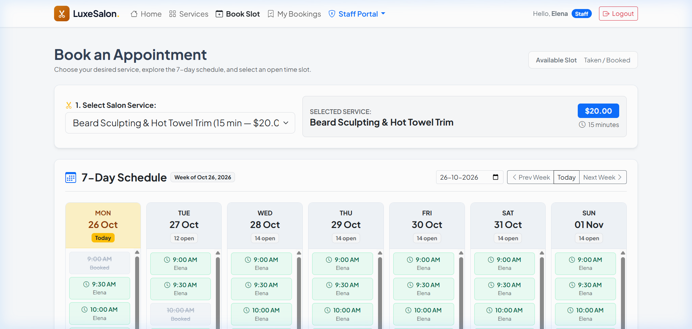
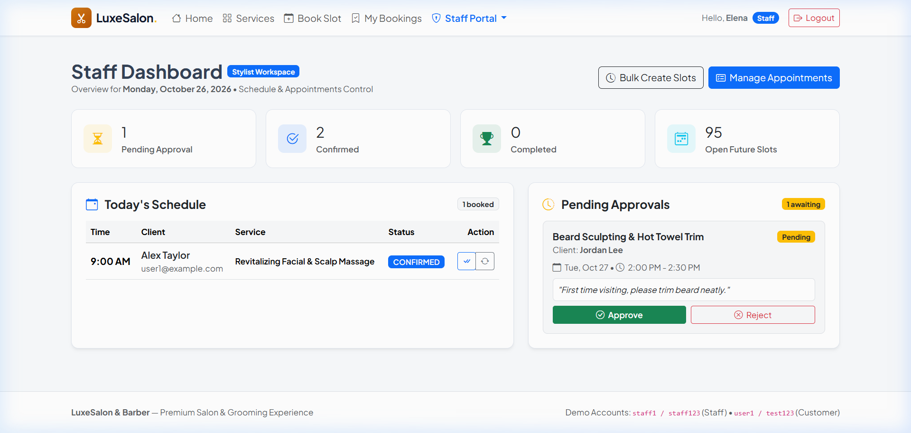
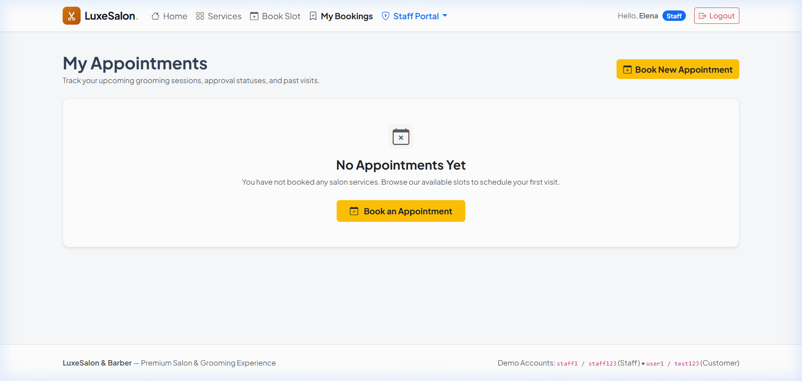
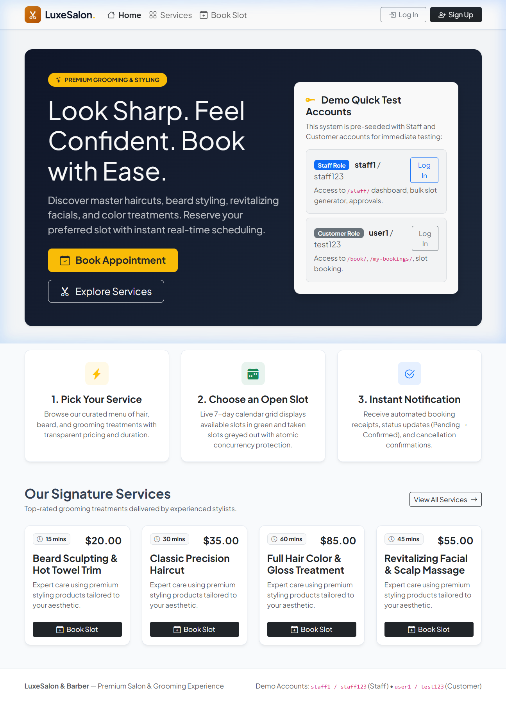
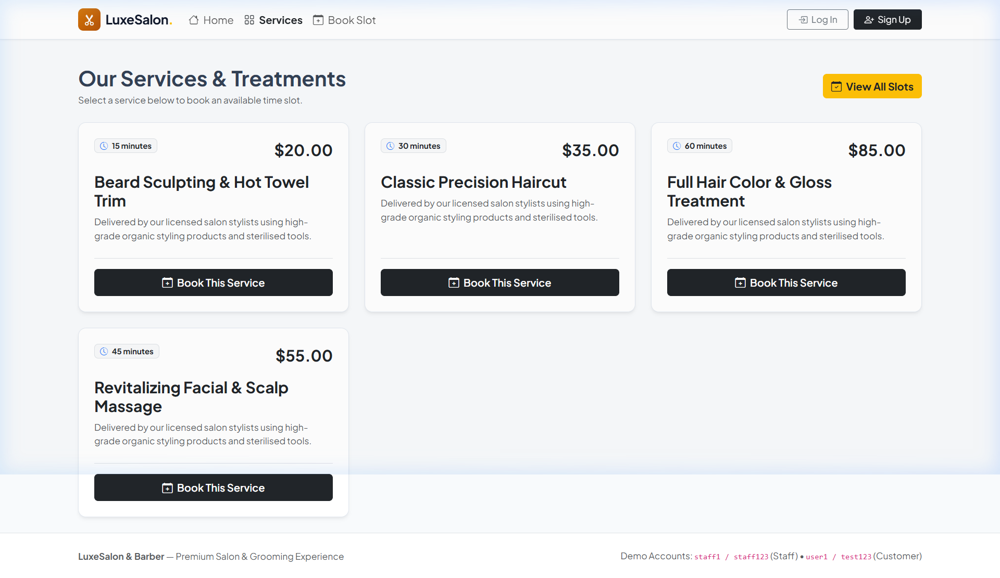

# ✂️ LuxeSalon & Barber — Django Appointment & Booking System

[](https://www.djangoproject.com/)
[](https://www.python.org/)
[](https://getbootstrap.com/)
[](https://www.sqlite.org/)
[](#-automated-tests)

A modern, full-featured appointment scheduling and salon management platform built with **Django 5**, **SQLite**, and **Bootstrap 5**. Designed with production-ready concurrency control, role-based workflows (Staff vs. Customer), bulk slot generation, and real-time appointment approvals.

---

## 🌐 Live Preview & Access Links

- **Local Live Server**: [http://127.0.0.1:8000/](http://127.0.0.1:8000/)
- **Customer Booking Calendar**: [http://127.0.0.1:8000/book/](http://127.0.0.1:8000/book/)
- **Staff Operations Dashboard**: [http://127.0.0.1:8000/staff/](http://127.0.0.1:8000/staff/)
- **Django Admin Portal**: [http://127.0.0.1:8000/admin/](http://127.0.0.1:8000/admin/)

---

## 🖼️ Application Screenshots

### 1. 7-Day Live Booking Calendar Grid
*Interactive week view displaying real-time available slots as green buttons and taken slots greyed out with atomic modal confirmation.*


### 2. Staff Management Dashboard
*Live staff cockpit tracking today's agenda, pending approval counters, and quick actions.*


### 3. Customer Portal — "My Bookings"
*Track booked services, assigned stylist, real-time status badges, and safe self-cancellation.*


### 4. Salon Landing Page & 1-Click Demo Login
*Customer welcome banner, service highlights, and instant 1-click test credential helpers.*


### 5. Services & Pricing Catalog
*Menu of active salon treatments with durations, descriptions, and direct booking links.*


---

## 🏛️ Architecture Overview (3–4 Lines)

> The application implements an MVT (Model-View-Template) architecture dividing concerns between domain models (`Service`, `TimeSlot`, `Appointment`), role-based group controllers (`@staff_required`, `@login_required`), and transactional booking views. Concurrency safety is enforced directly at the database engine using `select_for_update()` row-level locks inside `transaction.atomic()` blocks coupled with schema-level `OneToOneField` and `UniqueConstraint` guards. This architecture guarantees zero double-booking races while decoupling dev-friendly console notifications and customer state transitions.

---

## 🛠️ Tech Stack

- **Backend Framework**: Django 5.2.x (Python 3.12)
- **Database**: SQLite 3 with strict relational integrity & composite constraints
- **Frontend / UI**: Django Templates, Bootstrap 5.3, Bootstrap Icons (CDN), Google Fonts (*Plus Jakarta Sans*)
- **Client Scripting**: Vanilla JavaScript (AJAX endpoints, modal state sync, auto-dismissing alerts)
- **Email Engine**: Django Console Email Backend (`console.EmailBackend`)
- **Testing & Quality Assurance**: Django `TestCase`, Django Test Client, transaction simulation, `mail.outbox` assertions

---

## ✨ Features List

### 👥 Authentication & Role-Based Access
- **Django Group Roles**: Explicit separation between **Staff** and **Customer** groups.
- **Role Selection at Signup**: Custom `UserCreationForm` with radio buttons enabling registrants to pick their account type.
- **Security & 403 Pages**: Non-staff users accessing `/staff/` receive a dedicated, friendly HTTP 403 "Staff Only" page with account switching helpers.
- **Quick Demo Fillers**: Pre-configured 1-click login buttons for testing both roles immediately.

### 📅 Booking & Calendar Scheduling
- **7-Day Dynamic Grid**: Week calendar showing daily open slots in emerald green and booked/past slots greyed out.
- **Race Condition Prevention**: Employs `select_for_update()` during reservation so simultaneous bookings cleanly reject the second buyer with: *"This slot was just taken! Someone booked it moments ago."*
- **Schema-Level Protection**: `Appointment.slot` is a `OneToOneField`, rendering duplicate booking attempts mathematically impossible in the SQL schema.
- **Customer Self-Service**: Customers can view booking history, status badges, and safely cancel pending/confirmed appointments (freeing the slot automatically).

### 💈 Staff Management & Operations
- **Staff Dashboard**: Real-time summary counters (Pending Approvals, Confirmed, Completed, Open Future Slots) and today's schedule table.
- **Bulk Slot Generation**: Generates non-overlapping shifts across customized time windows and durations (15m, 30m, 45m, 60m).
- **Appointment Lifecycle Management**:
  - **Approve**: Transitions `Pending` &rarr; `Confirmed`.
  - **Complete**: Marks appointment finished upon client visit.
  - **Cancel**: Releases the time slot back to the public pool.
  - **Atomic Rescheduling**: Swaps the booking to any available future slot while releasing the previous slot in a single transaction.

### 📨 Notification Engine (Dev Console)
- Emits formatted email receipts to the terminal for:
  1. Booking request submitted (Pending)
  2. Booking approved by staff (Confirmed)
  3. Booking cancelled by customer or staff
  4. Appointment rescheduled to a new time window

---

## 🔑 Pre-Seeded Demo Credentials

| Role | Username | Password | Access Capabilities |
| :--- | :--- | :--- | :--- |
| **Staff Member** | `staff1` | `staff123` | Full access to `/staff/` dashboard, slot generation, and approvals |
| **Customer 1** | `user1` | `test123` | Booking appointments, managing `/my-bookings/`, cancellation |
| **Customer 2** | `user2` | `test123` | Booking appointments, managing `/my-bookings/` |

---

## ⚡ Installation & Setup

### 1. Clone the Repository
```bash
git clone https://github.com/Wanderer449/luxe-salon-bookin-app.git
cd luxe-salon-bookin-app
```

### 2. Install Dependencies
```bash
pip install -r requirements.txt
```

### 3. Run Database Migrations
```bash
python manage.py migrate
```

### 4. Seed Demo Data
```bash
python manage.py seed_demo
```

### 5. Launch the Local Server
```bash
python manage.py runserver
```
Visit **`http://127.0.0.1:8000/`** to view the application.

---

## 🧪 Automated Tests

The application includes an extensive automated test suite covering authentication, overlapping interval detection, atomic race conditions, access restrictions, and email dispatches:

```bash
python manage.py test
```

```text
Ran 17 tests in 29.8s
OK (System check identified no issues)
```
